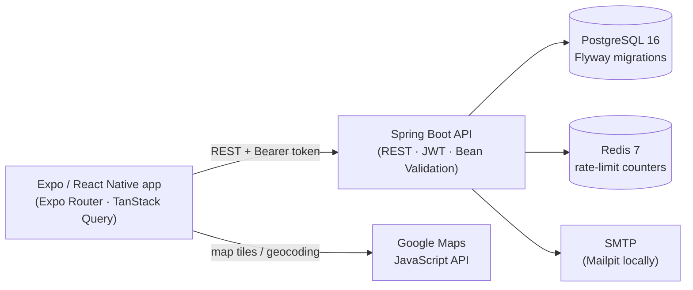
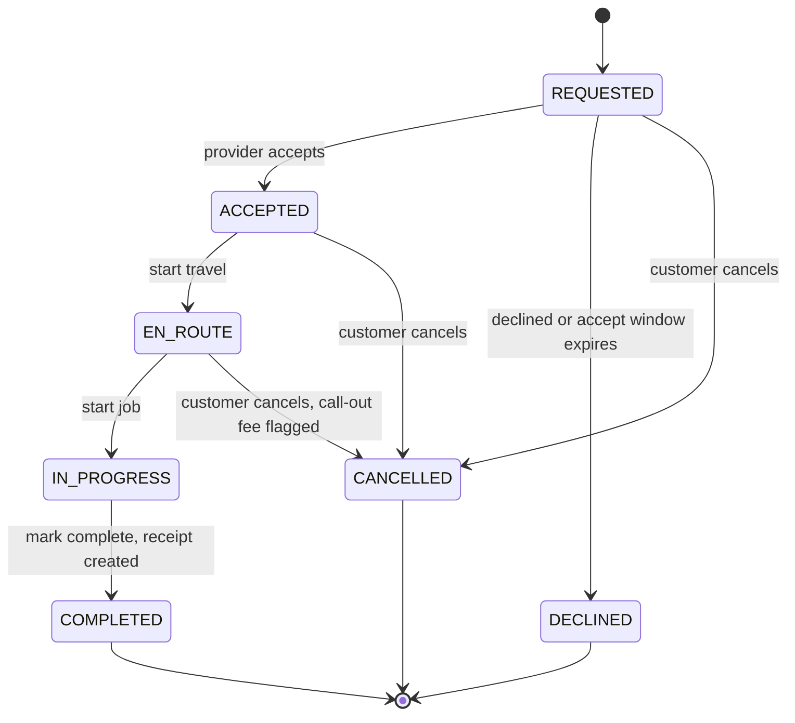

# QuickFixHub

**A cross-platform service marketplace** connecting customers with trusted local service
providers — plumbers, electricians, cleaners, technicians — with in-app booking, live job
tracking, chat, reviews, and an admin console for provider verification and refunds.


---

## Contents

- [Features](#features)
- [Screenshots](#screenshots)
- [Architecture](#architecture)
- [Booking lifecycle](#booking-lifecycle)
- [Tech stack](#tech-stack)
- [Getting started](#getting-started)
- [Configuration](#configuration)
- [API surface](#api-surface)
- [Project layout](#project-layout)
- [Development workflow](#development-workflow)
- [Roadmap](#roadmap)
- [License](#license)

---

## Features

### Customer
- **Discovery** — browse by category, search by name / city, filter by verified status, or
  find providers within a radius of your location on a map.
- **Provider profiles** — services and pricing, ratings and reviews, verified badge, photo
  and cover image.
- **Booking lifecycle** — request a slot → provider accepts → *en route* → *in progress* →
  *completed*, with a live status timeline and an accept-window countdown. Cancel while a
  job is still cancellable.
- **Chat** — message the provider on any booking, plus a conversations list across every
  thread.
- **Reviews** — rate a completed job 1–5 with quick-select tags and a comment.
- **Receipts** — every completed booking produces a receipt (mocked payment ledger).
- **Saved providers**, saved addresses, profile & cover photos.
- **Contact** — call or message a provider once you have a booking with them.

### Provider
- **Onboarding** — business profile, services & pricing (Rs. 2,000 minimum), and
  verification documents (National ID + trade licence required; insurance and proof of
  address optional).
- **Dashboard** — incoming requests with countdowns, today's schedule, upcoming jobs, and
  earnings-this-week / rating / accept-rate tiles.
- **Job actions** — accept / decline / start travel / start job / mark complete.
- **Availability** — weekly open hours and a service-area radius *(display-only for now — see
  the roadmap)*.
- **Verification status** — track pending / approved / rejected and re-submit documents.

### Admin
- **Overview** — real aggregate stats (users, providers, bookings, revenue, refunds) and a
  "needs attention" callout.
- **Verification queue** — review submitted documents per provider, leave internal notes,
  and approve / reject / request more documents (each decision emails the provider).
- **Payments & refunds** — browse paid bookings and issue full or partial refunds.

### Platform
- **Auth** — email / password with JWT access tokens and rotating opaque refresh tokens,
  login rate limiting, and **password reset by email** (6-digit code, single-use,
  attempt-capped).
- **Transactional email** (SMTP) — welcome, password-reset code, and password-changed alert.
- **In-app notifications** — booking updates, new messages, and verification decisions, with
  an unread badge *(polled; OS push is on the roadmap)*.
- **Theme** — light / dark / system, remembered per device.

---

## Screenshots

| Home | Provider detail | Booking tracking | Admin verification |
| --- | --- | --- | --- |
| _add_ | _add_ | _add_ | _add_ |

> Drop PNGs into `docs/screenshots/` and replace the cells with, e.g.,
> ``.

---

## Architecture



- **Stateless auth.** Short-lived JWT access tokens; opaque refresh tokens are stored
  hashed in Postgres and rotated on every refresh, so a stolen token can be revoked.
- **No server-rendered UI.** The API is JSON-only; the app owns all rendering and
  navigation (Expo Router file-based routes under `mobile/src/app`).
- **Polled, not pushed.** Chat and notifications poll on an interval — there is no
  WebSocket/STOMP transport or FCM/APNs push yet. Both are on the roadmap and the data
  model is already in place.
- **Media inline.** Profile photos and verification documents are stored as base64 data
  URIs on the row (object storage is a roadmap item).

---

## Booking lifecycle



Every transition is a guarded endpoint scoped to the caller (customer or the provider
behind the booking's profile), and each writes its own timestamp so the app can render a
history timeline without a separate audit table.

---

## Tech stack

| Area | Choice |
| --- | --- |
| Mobile | React Native `0.86` · Expo SDK `57` · Expo Router · TypeScript · TanStack Query · axios |
| Backend | Spring Boot `4.1` (Spring `7`) · Java `21` · Spring Security · Bean Validation |
| Data | PostgreSQL `16` · Flyway (`V1`–`V23`) · Redis `7` |
| Auth | `jjwt` `0.13` (HS384) · BCrypt · opaque DB-hashed refresh tokens |
| Email | `spring-boot-starter-mail` (SMTP) · Mailpit for local dev |
| Maps | Google Maps JavaScript API, rendered through `react-native-webview` |
| Media | base64 data URIs in Postgres (S3 on the roadmap) |
| API docs | springdoc OpenAPI / Swagger UI |
| Infra | Docker Compose (Postgres + Redis + Mailpit) · GitHub Actions (secret scan) |

---

## Getting started

### Prerequisites
- **Java 21+**, **Node.js 20+**, **Docker Desktop**, and the **Expo Go** app on your phone
  (or an Android/iOS emulator)

### Backend
```bash
cd backend
cp .env.example .env          # sensible local defaults — nothing required to fill in
docker compose up -d          # Postgres + Redis + Mailpit
./gradlew bootRun             # applies migrations, starts on :8080
```
- API docs — `http://localhost:8080/swagger-ui.html`
- Local email inbox (Mailpit) — `http://localhost:8025`

### Mobile
```bash
cd mobile
cp .env.example .env          # then edit EXPO_PUBLIC_API_BASE_URL (see below)
npm install
npx expo start                # scan the QR code with Expo Go
```
On a physical phone, `localhost` points at the **phone**, not your computer — set
`EXPO_PUBLIC_API_BASE_URL` to your machine's Wi-Fi / LAN IP, e.g.
`http://192.168.1.20:8080`. The backend has **no** `/api/v1` prefix.

### Demo accounts
Seeded on first run; password `Password123!`.

| Role | Email |
| --- | --- |
| Admin | `admin@quickfixhub.local` |
| Provider | register your own from the app |
| Customer | register your own from the app |

---

## Configuration

All backend config is environment-driven — see
[`backend/.env.example`](backend/.env.example). Notable groups:

| Group | Notes |
| --- | --- |
| **Database / Redis** | Connection strings. Local ports are remapped on some machines via `docker-compose.override.yml`. |
| **JWT** | `JWT_SECRET` (≥ 32 chars) and access / refresh token TTLs. |
| **Email / SMTP** | Defaults target the local **Mailpit** container — nothing is actually delivered. To send real mail, swap the `SMTP_*` block; a ready-to-fill **Gmail** block (App Password, port 587, STARTTLS) is included in `.env.example`. |
| **Google Maps** | `EXPO_PUBLIC_GOOGLE_MAPS_API_KEY` on the mobile side — the key needs the **Maps JavaScript API** enabled. |

---

## API surface

Grouped by controller — full request / response schemas live in Swagger UI.

| Group | Endpoints |
| --- | --- |
| `/auth` | register · login · refresh · logout · forgot-password · reset-password |
| `/me` | profile · photo / cover-photo · addresses · saved-providers · conversations · notifications |
| `/me/provider-profile` | create · services · availability · verification · documents · bookings |
| `/providers` | search (with radius) · detail · reviews |
| `/categories`, `/services` | public catalog |
| `/bookings` | create · list · lifecycle transitions · cancel · messages · reviews · payment |
| `/admin` | overview · verification queue + decisions · payments + refunds |

---

## Project layout

```
quickfixhub/
├── backend/                 Spring Boot API
│   ├── src/main/java/…       controllers · services · JPA entities
│   ├── src/main/resources/
│   │   └── db/migration/     Flyway migrations V1–V23
│   └── docker-compose.yml    Postgres · Redis · Mailpit
├── mobile/                   Expo React Native app
│   └── src/
│       ├── app/              Expo Router routes  ((auth) · (app))
│       ├── api/              typed API client
│       ├── components/       shared UI + design-system primitives
│       └── theme/            light / dark / system
└── .github/                  CI workflow · Dependabot · PR template
```

---

## Development workflow

- **Branching** — feature branches off `dev`; `dev` is the integration branch.
- **Migrations** — never edit a shipped Flyway migration; add `V{n+1}__description.sql`.
  Hibernate runs in `validate` mode, so entities and schema must agree.
- **Before a PR** — `./gradlew test` (backend); `npx tsc --noEmit` and `npx expo lint`
  (mobile).

---

## Roadmap

Where the app can go next, roughly in order of leverage. Grouped by theme; no committed dates.

### Real-time & notifications
- **OS push notifications** — `expo-notifications` + FCM/APNs behind a dev-client build.
  The in-app notification store, types, and triggers already exist; this only adds the
  delivery transport.
- **WebSocket / STOMP** — replace polling for chat and live booking status so progress and
  new messages appear instantly.
- **Provider location streaming** — a real "4 min away" ETA on the tracking screen, backed
  by periodic location pings.

### Payments
- **Real payment gateway** — Stripe or a Sri-Lanka processor (PayHere / FriMi). The
  `payments` ledger schema was built to swap the "how does PAID happen" step without a
  rewrite.
- **Provider payouts & escrow** — hold funds until a job completes, release minus a
  platform fee; a provider earnings / payout-history screen.
- **Enforce the cancellation fee** — `cancellationFeeApplies` is flagged once a provider is
  en route but nothing charges it yet.

### Disputes & trust
- **Customer-raised disputes** — evidence upload, an SLA countdown, a booking timeline, and
  an admin "side with provider / refund" resolution flow (the payments screen is a stand-in
  for this today).
- **Masked calling** — proxy phone numbers instead of revealing a provider's real number.
- **Third-party background / ID checks** during verification, plus **review moderation**.

### Admin
- **Users tab** — browse, search, suspend, and promote users. There is currently no in-app
  admin management surface and no path to create an admin except the seed row.
- **Analytics** — retention, category demand, provider funnel, revenue trends.

### Provider tooling
- **Availability that gates booking** — weekly hours and the service radius are display-only
  today; they should constrain which slots a customer can request and which providers
  appear in a radius search.
- **Calendar view** with recurring / holiday availability.
- **Portfolio** — multiple work photos per provider, not just one avatar + cover.

### Media & infrastructure
- **Object storage** — move photos and documents from base64-in-Postgres to S3 + a CDN.
- **Full CI** — backend build + test and mobile typecheck + lint + EAS build on every PR
  (today CI only runs a secret scan).
- **Deployment** — containerised backend on AWS with managed Postgres / Redis, EAS build &
  submit for the app; scope CORS down from the dev-wide localhost pattern and read the
  client IP from a trusted forwarded header for rate limiting.
- **Observability** — structured logs, metrics, and error tracking.

### Localization & access
- **Sinhala / Tamil** UI language support for the Sri Lanka market.
- **Social / OAuth login** and biometric app unlock.
- **Accessibility pass** — dynamic type, screen-reader labels, contrast audit.

---

## License

Not yet licensed — © Bimsara Sanduneth. All rights reserved. Open an issue if you'd like to
use any part of this.
